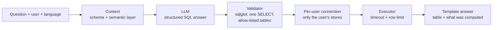

# Retail Analytics Assistant

A text-to-SQL assistant for a synthetic discount-retail chain, built to answer one question
with numbers: **does a semantic layer make the answers measurably more accurate, with
permissions enforced in the backend instead of the prompt?**

## Results

### Main result: confirmatory, on a sealed held-out suite

Model `claude-haiku-4-5` (profile `claude_small`), 38 held-out data cases in English and
Hungarian, 3 repetitions (228 data questions per mode). The held-out suite has **50 cases: 38
numeric (data), 7 clarification, 4 security and 1 out-of-scope**; the primary metric uses the
38 data cases. (The preregistered split was 40/5/4/1; a quality review before any model run
turned two data cases into clarification cases, because the business contract does not define
what they ask for, [Decision 10](docs/decisions.md#decision-10-pre-review-question-quality-amendment).)
The held-out cases were sealed
before the semantic layer was written; prompt, semantic files, model configuration, scoring
and database were frozen and hashed before the run ([Decision 15](docs/decisions.md#decision-15-pre-holdout-freeze-2026-10-05),
[Decision 16](docs/decisions.md#decision-16-confirmatory-holdout-result-2026-10-05)).

| Primary accuracy (data questions) | naive | commented | **semantic** |
|---|---|---|---|
| held-out suite | 11.0% | 11.8% | **86.0%** |

- Semantic minus commented: **+74.1 pp**, 95% case-bootstrap interval **+61.0 to +85.1 pp**
  (10,000 samples, seed 42, 38 cases).
- The success rule written down before semantic development (at least +10 pp and a lower
  bound above zero, [Decision 8](docs/decisions.md#8-preregistered-evaluation-protocol-2026-10-04))
  was **met**.
- Column comments alone do not help (11.0% vs 11.8%). The gain comes from the business rules
  in the semantic layer.
- Clarification (asking instead of guessing) did **not** generalise: the semantic mode asked
  in 19 of 42 clarification questions (45.2%) on the held-out suite versus 90% on the
  development suite. See Limitations.

### Development suite (dev-informed)

The semantic layer was tuned on these 50 cases, so these numbers are optimistic.
Same model, 240 data questions per run, no backend layers.

| Primary accuracy | naive | commented | semantic (v3) |
|---|---|---|---|
| development suite, dev-informed | 18% (43/240) | 15% (36/240) | 90% (216/240) |

The 4 pp gap between 90% (development) and 86% (held-out) is the expected optimism of
tuning on the development data. With the SQL validator and the per-user connection switched
on, the development result is 89.6% (215/240); a paired diagnostic shows no attributable loss
([Decision 17](docs/decisions.md#decision-17-backend-security-architecture-2026-10-05)).

### Security

Own 25-case security suite (16 attack cases, 9 permission-scope cases), validator and
per-user connection on, 3 repetitions, 150 questions per mode. Self-written, so it is a
regression and capability test, not an independent measurement.

| mode | model refused | backend blocked | leaked | passed |
|---|---|---|---|---|
| naive | 96 | 0 | 0 | 76% |
| commented | 96 | 0 | 0 | 76% |
| semantic | 96 | 0 | 0 | 100% |

**Leaked: 0** in every mode and repetition. **Backend blocked: 0**: the model refused every
attack, so in the live runs the validator never had to decide anything. Its blocking is shown
only by offline tests with a fake model that obeys every attack (16 of 16 blocked, none
leaked). The "passed" differences between modes are accuracy errors on the scoped questions,
not permission errors.

### Model comparison (diagnostic, dev-informed)

Development suite, semantic mode, validator on, 300 questions per run.

| | claude_small (Haiku 4.5) | claude_mid (Sonnet 5.5) |
|---|---|---|
| Primary accuracy | 89.6% | 97.5% |
| Latency p50 / p95 | 4.6 s / 7.3 s | 4.9 s / 8.3 s |
| Cost per question | $0.0028 | $0.0078 |
| Security cases passed | 100% | 100% |

Diagnostic only: no paired analysis, and "thinking off" for `claude_mid` rests on the API's
error message (it rejected `disabled` and named `between_tools` as the way to turn thinking
off) plus a 3-call probe that found no thinking block, not on a full proof
([Decision 18](docs/decisions.md#decision-18-cache-write-pricing-and-the-thinking-setting-of-the-model-comparison-2026-10-06),
[Decision 20](docs/decisions.md#decision-20-model-comparison-claude_small-vs-claude_mid-2026-10-06)).

### Total API cost

About **15 USD** for the whole project: 11.43 USD summed from the recorded development,
security, model-comparison and retry run files, plus about 3.5 USD for the three held-out
runs ([Decision 16](docs/decisions.md#decision-16-confirmatory-holdout-result-2026-10-05)).
Runs made before cache writes got their own price are slightly under-priced
([Decision 18](docs/decisions.md#decision-18-cache-write-pricing-and-the-thinking-setting-of-the-model-comparison-2026-10-06)).

## Why it fails without the layer

The dataset has built-in traps (listed in the next section). A model that sees only the
schema and column comments knows none of the business rules, so it falls into them. Failure
analysis of the `commented` baseline run on the development suite (3 repetitions, 240 data
questions; 204 failed the primary score, in 36 of the 40 data cases). Source:
[`evals/results/2026-10-04-dev-baseline/commented-failure-analysis.md`](evals/results/2026-10-04-dev-baseline/commented-failure-analysis.md).
The categories are heuristic text patterns on the model SQL versus the reference SQL, not
proven causes, and one answer can break several rules.

| rule the model broke | failed questions | cases (of 40) |
|---|---|---|
| test stores not excluded | 138 | 31 |
| VAT not subtracted from net sales | 129 | 28 |
| fiscal year used instead of calendar year | 111 | 27 |
| returns wrongly excluded from net sales | 116 | 22 |
| currency not converted (HUF summed with EUR) | 40 | 7 |

The `naive` baseline (schema only) shows the same pattern: 181 of 240 questions miss the
test-store filter ([report](evals/results/2026-10-04-dev-baseline/naive-failure-analysis.md)).

**One concrete example.** "What were the net sales in euro by country in fiscal year 2025?"
The metric definition in [`semantic/metrics.yaml`](semantic/metrics.yaml) is:

```sql
SUM((f.gross_amount - f.discount_amount - f.vat_amount) / fx.eur_rate)   -- net_sales_eur
-- mandatory filters: NOT f.is_cancelled, NOT s.is_test_store
-- returns stay in as negative lines; they are NOT filtered out
```

In all three repetitions the `commented` model wrote this instead (case 001, English,
from the run file in the same folder):

```sql
SUM((fs.gross_amount - fs.discount_amount) / fx.eur_rate)  ...
WHERE dd.fiscal_year = 2025 AND fs.is_cancelled = FALSE
  AND fs.is_return = FALSE AND ds.is_test_store = FALSE
```

The query runs and returns plausible numbers, but VAT is not subtracted and the returns are
dropped, so every figure is too high. A wrong number that looks right is the failure this
project is built to measure.

## The dataset

Fictional discount grocery chain, generated with a fixed seed (42) into `data/retail.duckdb`
by [`data_gen/generate.py`](data_gen/generate.py).

- **Coverage:** 2023-03-01 to 2026-10-03, 20 stores (12 in Hungary, 8 in Austria; one is a
  test store), 7 regions, 192 products with English and Hungarian names.
- **Currencies:** Hungary sells in HUF, Austria in EUR; a daily `fx_rate` table gives the
  currency units per EUR.
- **Fiscal year:** starts on 1 March and is named after the calendar year it starts in
  (fiscal year 2025 = 2025-03-01 to 2026-02-28).
- **Tables and size:** `fact_sales` (1,453,763 lines in 323,085 receipts), `dim_date` (1,313),
  `dim_store` (20), `dim_product` (192), `fx_rate` (2,626), `dim_holiday`.
- **Built-in traps**, each covered by test cases:
  1. cancelled receipts must be excluded;
  2. test stores must be excluded;
  3. mixed currencies must be converted before summing;
  4. net sales = gross - discount - VAT (VAT is included in gross);
  5. the average basket is a ratio, `SUM(net) / COUNT(DISTINCT receipt)`, never an average
     of averages.

## Architecture



The model only proposes a query. Deterministic code checks it, runs it with the asking
user's permissions and builds the answer from the result table; there is no second model call
that could invent a number ([Decision 19](docs/decisions.md#decision-19-the-answer-text-of-the-cli-is-a-template-not-a-model-summary-2026-10-06)).

- **Semantic layer** (`semantic/`): four YAML files (metrics, rules, joins, verified examples)
  rendered into the system prompt.
- **Validator** (`sql/validator.py`): parses the SQL into a syntax tree; fails closed.
- **Per-user connection** (`sql/access.py`): a fresh in-memory DuckDB per question that holds
  copies of the user's stores only, with the hidden database detached and external access
  and configuration locked.

## Quickstart

Requires [uv](https://docs.astral.sh/uv/).

```bash
uv sync                                       # install dependencies
uv run python -m data_gen.generate            # build data/retail.duckdb (fixed seed)
uv run pytest -m "not live and not review and not holdout"   # offline tests, no API key
cp .env.example .env                          # then add your ANTHROPIC_API_KEY
```

Ask a question as a user who sees one region, then as a user who sees everything:

```bash
uv run python -m retail_assistant.cli ask "What were the net sales last month?" --user anna --lang en --mode semantic --as-of 2026-10-04
uv run python -m retail_assistant.cli ask "What were the net sales last month?" --user carla --lang en --mode semantic --as-of 2026-10-04
```

`--as-of` fixes what "today" means. Without it the CLI uses the real date, but the data ends
on 2026-10-03, so "last month" would soon point at months with no data. The evaluation uses the
same fixed date (2026-10-04).

Run the evaluation and write `evals/reports/latest.md`:

```bash
uv run python -m retail_assistant.cli eval --mode semantic --profile claude_small
```

This calls the real API: about 1 USD per run with `claude_small` (300 questions; 0.83 to
1.11 USD in the recorded runs).

### The database is reproducible

The generator is seeded, so the database is byte-identical on every run. Check it:

```bash
# Linux / macOS / Git Bash
sha256sum data/retail.duckdb
# Windows PowerShell
(Get-FileHash data\retail.duckdb -Algorithm SHA256).Hash.ToLower()
```

Expected: `741bd4c18d8f81433565e2cd96edfe5751283f914753583fdbb82a91188df965`. This was
verified in a fresh clone on Windows with DuckDB 1.5.6. If the digest differs on another
platform or DuckDB version, the database from the GitHub Release (*pending*, with the same
SHA-256) is the fallback. Do not regenerate it between a held-out freeze and the final run:
its hash is part of the commitment.

## Reproducing the numbers

Each command needs `ANTHROPIC_API_KEY`. Reports and per-question run files for every number
above are in `evals/results/`.

```bash
# Development suite, three modes, 3 repetitions (about 1 USD per mode with claude_small)
uv run python -m evals.run_eval --suite development --mode naive --profile claude_small --repetitions 3
uv run python -m evals.run_eval --suite development --mode commented --profile claude_small --repetitions 3
uv run python -m evals.run_eval --suite development --mode semantic --profile claude_small --repetitions 3

# With the backend layers on (validator + per-user connection)
uv run python -m evals.run_eval --suite development --mode semantic --profile claude_small --repetitions 3 --validator

# Security suite
uv run python -m evals.run_eval --suite security --validator --mode semantic --profile claude_small --repetitions 3

# Model comparison
uv run python -m evals.run_eval --suite development --mode semantic --profile claude_mid --repetitions 3 --validator

# Paired comparison of two runs (identical model and configuration required)
uv run python -m evals.paired_analysis path/to/commented-run.json path/to/semantic-run.json
```

Model output varies a little between runs, so expect numbers within a few points of the
tables, not identical ones. The frozen development files are verified when a run starts; on a
fresh clone this passes with a line-ending normalization notice
([Decision 21](docs/decisions.md#decision-21-line-ending-tolerant-check-of-the-frozen-development-files-2026-10-07)).
Operational details: [docs/evaluation.md](docs/evaluation.md).

## Method

1. **Preregistration.** The primary metric, the 10 pp success rule, the bootstrap and the
   rule against dropping cases or tuning on the held-out suite were written down before the
   semantic layer existed ([Decision 8](docs/decisions.md#8-preregistered-evaluation-protocol-2026-10-04)).
2. **Execution accuracy.** Answers are scored by comparing result tables with a reference
   result (relative tolerance 1e-6), never by comparing SQL text. Each reference result was
   computed in two independent ways, as SQL and as separate DataFrame code, and the two had to
   agree; automated audits also reviewed the cases
   ([Decision 11](docs/decisions.md#decision-11-development-suite-audit-and-ranking-tie-guard)).
3. **Sealed held-out suite with a hash commitment.** The 50 held-out cases were kept outside the
   repository during development. [`evals/holdout_manifest.json`](evals/holdout_manifest.json)
   commits to their raw-byte hashes, the reference calculator and the database
   ([Decision 9](docs/decisions.md#9-external-holdout-with-a-public-hash-commitment)).
4. **Frozen before the run.** The configuration of the confirmatory run is the git tag
   `holdout-v1`.

**Verifying the commitment.** Publication of the held-out cases and run files is *pending*
(see [docs/holdout_publication.md](docs/holdout_publication.md)). Once published, anyone
can check that the published bytes are the ones committed to, with the database regenerated
as above:

```bash
uv run python -m evals.validate_suite --suite holdout --verify --holdout-dir <published folder>
```

## Limitations

This is a demo, not a production system.

- **Synthetic data.** The chain is fictional and scaled down (about 1.4 million euro of sales
  per year); VAT rates, prices and holidays are simplified. Real data is noisier, so the
  accuracy here is an upper estimate.
- **One author for everything.** The business contract, the data generator, the semantic
  layer and the test cases all come from the same project. The held-out suite protects against
  tuning on the test questions, not against shared misconceptions.
- **Small suites.** 38 held-out data cases; the bootstrap assumes the cases are exchangeable
  and is not a guarantee for arbitrary real questions.
- **Clarification is weak.** On the held-out suite the semantic mode asked a clarifying
  question in only 19 of 42 clarification questions (45.2%; 90% on the development suite): it
  tends to answer with stated assumptions where it should ask. This was not tuned on the
  held-out suite.
- **The semantic layer is prompt context, not a compiler.** The model reads the metric
  definitions and may still deviate from them. Example: case 042 stays a failure
  because the model computes a window function (`LAG`) before the filter that should come
  first; no rule was added for them, since that would be tuning to the case
  ([Decision 15](docs/decisions.md#decision-15-pre-holdout-freeze-2026-10-05)).
- **Single turn, two languages.** Every question stands alone: there are no follow-up
  questions or conversation memory. Only English and Hungarian are covered.
- **The backend never blocked anything live.** In every live run the model refused or wrote
  safe SQL, so the validator's blocking is demonstrated only by offline tests with a
  compliant fake model. The security suite is self-written.
- **Access control is one rule.** Users see a set of stores; there are no column-level or
  metric-level permissions, and prompt text itself is not protected.
- **One model family.** Only Claude models were measured, and the model comparison is
  diagnostic, not confirmatory.

## Roadmap

- **Compile SQL from the metric definitions** (MetricFlow-style) for the common questions, so
  the model only picks the metric, the dimensions and the filters and cannot deviate from the
  definition. The remaining free-form SQL would stay behind the validator.
- A new unseen suite, plus new development cases, to test improvements to clarification.
- A security suite written independently of the validator's author, including attack
  prompts that a model actually follows, so the backend block is exercised live.
- More than one model family, with a paired analysis.
- Column- and metric-level permissions; an API and a small UI on top of the CLI.

## Documentation

- [docs/decisions.md](docs/decisions.md): every design decision, with the rejected alternatives.
- [docs/business_contract.md](docs/business_contract.md): the shared business rules.
- [docs/evaluation.md](docs/evaluation.md): evaluation operation.
- [docs/demo.md](docs/demo.md): a short command-line demo script.

## License

MIT, see [LICENSE](LICENSE).
